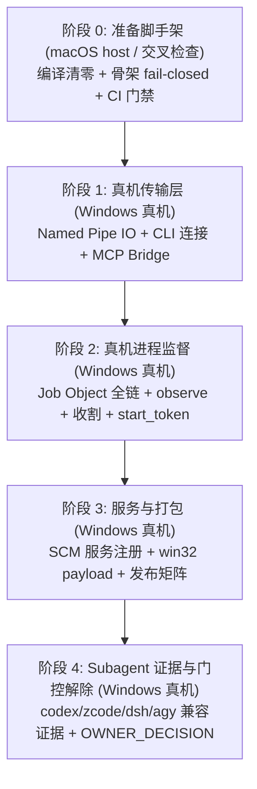

# Windows 分阶段移植计划 (PORT-PLAN)

## 背景、目标与权威

本移植计划依据决策清单 [DECISIONS.md](../../docs/initial-research/DECISIONS.md) 的 **D02** 项要求制定：
> 「要同时支持 Linux、Intel Mac 或 Windows，会新增进程回收、服务注册、权限执行与原生包验收，须扩展计划后再开工。包名所有权／发布凭据只能由用户授权。」

本计划是支持 Windows 平台的正式扩展计划，旨在建立清晰的分阶段演进路径，将跨平台差异化工作拆解为可独立判错、可递进交付的五个阶段（阶段 0 至阶段 4）。

### 核心设计原则与边界约束

1. **Unix 生产零回归（绝对不变量）**：全过程确保 macOS (Darwin) 与 Linux 生产环境行为零变化。宿主既有测试套件全绿是每一阶段的回归基石。
2. **脚手架与真机严格解耦**：
   - **阶段 0（本特性：windows-port-prep）**：仅在现有 macOS 开发机上完成编译阻断清零、接口抽象抽取、fail-closed 骨架搭建与 CI 门禁建设。骨架路径统一返回结构化错误（`io::ErrorKind::Unsupported` / 既有错误通道，消息统一带 `windows:` 前缀与 `pending real-machine implementation`），源码标注 `TODO(windows-real-machine)`。
   - **阶段 1–4（Windows 真机演进）**：真正的 Named Pipe I/O、Job Object 进程生命周期、Windows Service（SCM）系统服务注册、原生 win32 payload 发布与 Subagent 真机兼容性证据，严格推迟到 Windows 真机环境执行。
3. **支持承诺不动（OWNER_DECISION）**：阶段 0 绝不提前承诺 Windows 支持。`cli/main.mjs:23` 的 `SUPPORTED_PLATFORMS`、`cli/install/layout.mjs:19` 的 `NATIVE_PLATFORMS`、`package.json:23-26` 的 `os` 字段及 `tests/platform/windows.test.mjs` 中的 17 个业务命令结构化拒绝断言保持原样，直至阶段 4 真机全套验收通过并由 Owner 显式批准后方可解除。

### 批准前验证入口（门控保持期间）

在 `cli/main.mjs:343-347` 平台拒绝门保持期间，公共 CLI 业务命令在 win32 上预期抛出 `UNSUPPORTED_PLATFORM` 错误并阻断执行（该拒绝本身是关键回归锚，由 `tests/platform/windows.test.mjs:40-47` 固化）。

在此门控保持期间，win32 真机上的验证入口为以下三种库层/系统层等价形式：
1. **直接 spawn daemon 二进制**：`target/debug/external-subagentd --database <abs.sqlite3> --socket <abs>`（daemon 核心服务进程自身无 CLI 层门控；`--database`（或 env `EXTERNAL_SUBAGENT_STORE`）为必填先决条件——daemon 启动时强制要求，见 `crates/external-daemon/src/main.rs:371-398`）；
2. **通过 Node 库层调用 RPC 方法**：经 `node -e` 直接 `import('./cli/rpc.mjs')` 调 RPC 方法（库层绕过 `cli/main.mjs` 门控，如 wire 方法 `agent_probe`、`submit_general`——后者为任务创建入口，对应 CLI 库命令 `spawn`/`create`，见 `crates/external-daemon/src/rpc/types.rs:94-96`）；
3. **MCP facade 直连**：通过 external-mcp 或测试客户端直接连接 named pipe 传输端点。

阶段 1–4 各阶段的「验证命令」凡引用公共 CLI 业务命令处，均改为或注明上述批准前入口的等价形式。

---

## 阶段演进总览



---

## 阶段 0 — Windows 兼容准备脚手架（本特性）

- **执行环境**：macOS (Darwin) 开发宿主机；交叉编译使用已安装的 `mingw-w64` + Rust `x86_64-pc-windows-gnu` target。
- **业务目标**：全 workspace 交叉编译通过；建立平台差异矩阵与移植计划文档；RPC 传输层解耦（提取 transport 共享层 + named pipe fail-closed 骨架）；`external-runtime` 进程监督平台接口收敛（`gated_spawn` 咽喉点前置拒绝 + Job Object 骨架）；CLI win32 路径规范与服务 fail-closed 骨架；配置 GitHub Actions Windows CI 校验。

### 入口 file:line
- `crates/external-runtime/src/lib.rs:34-37`（`gated_spawn` 首部加 `#[cfg(windows)]` 早退拒绝）
- `crates/external-runtime/src/lib.rs:561-604`（`respond_before` / `write_frame_before` 加 `#[cfg(not(unix))]` fail-closed 臂）
- `crates/external-runtime/src/lib.rs` 既有 platform 区（新增 `kill_group`/`kill_process` 监督助手）
- `crates/external-runtime/src/bin/orphan-spawn-test.rs:2`（双 main 源码 cfg 门控）
- `crates/external-daemon/src/rpc.rs:18-24`（RPC 三分：抽取 `transport.rs`，增加 `windows.rs` 骨架桩）
- `crates/external-daemon/src/lib.rs:23, 1675-1678`（PermissionsExt 门控与 `Daemon` windows 骨架桩）
- `crates/external-daemon/src/scheduler/diagnostics.rs:540-545, 559-563`（`.mode(0o600)` 改为局部 unix 门控链）
- `crates/external-daemon/src/scheduler/admission.rs:184-196`（未门控 `libc::kill` 迁移至共享 `kill_group`/`kill_process`）
- `crates/external-daemon/src/main.rs:12, 55-56, 343-365`（signal_hook 注册与 debug gate cfg 拆分）
- `crates/external-mcp/src/lib.rs:6, 12`（`UnixStream::connect` cfg 拆分）
- `cli/paths.mjs:75-77`（`windowsProductPaths` 12 字段平行结构与三分支分发）
- `cli/install/service-macos.mjs:179-202`（`uid = process.getuid()` 移入 darwin 惰性求值；增加 win32 分发臂）
- `cli/install/service-activation.mjs:22-24`（`activateService` 增加 win32 分发臂）
- `tests/platform/windows.test.mjs:40-49`（保持既有 17 命令拒绝测试；新增测试 4 路径断言与测试 5 分发拒绝断言）
- `.github/workflows/windows-check.yml`（计划新增，行号待产物生成后核证：新增 windows-latest CI workflow）

### 验收标准 (AC)
1. 交叉编译通过：`cargo check --workspace --target x86_64-pc-windows-gnu` 报 **0 error**。
2. 宿主测试全绿：host `cargo test --workspace` 全绿；`cargo build --workspace --bins` 后 `node --test tests/platform/*.test.mjs tests/cli/*.test.mjs tests/install/*.test.mjs` 全绿。
3. 骨架语义验证：
   - 源断言确认 `gated_spawn` 的 windows 拒绝位于 `command.spawn()` 之前；
   - win32 路径阶段测试 4 验证 `windowsProductPaths` 的 LOCALAPPDATA 注入/回退、socket 管道命名、launchAgent 为 null；
   - win32 路径阶段测试 5 验证 win32 平台下服务操作直接抛出结构化 `CliError('UNSUPPORTED_PLATFORM_SERVICE', ...)`。
4. CI 语法有效：`.github/workflows/windows-check.yml` 通过本机 YAML 解析校验。
5. 两个文档健全：`docs/windows-port/PLATFORM-MATRIX.md` 覆盖 10/10 构造族且四列完整；`docs/windows-port/PORT-PLAN.md` 覆盖五阶段且四要素齐备。

### 验证命令
```bash
# 1. 交叉编译检查
env PATH="$HOME/.rustup/toolchains/1.97.1-aarch64-apple-darwin/bin:$PATH" cargo check --workspace --target x86_64-pc-windows-gnu --message-format short

# 2. 宿主 Rust 测试
cargo test --workspace

# 3. 宿主二进制构建与 Node 测试
cargo build --workspace --bins
node --test tests/platform/*.test.mjs tests/cli/*.test.mjs tests/install/*.test.mjs

# 4. CI Workflow YAML 校验
python3 -c "import yaml; yaml.safe_load(open('.github/workflows/windows-check.yml'))"
```

### 证据要求
- 交叉编译 short message 输出 0 error 的终端日志。
- `cargo test --workspace` 所有用例 pass 的测试输出摘要。
- `node --test` 所有测试通过的输出结果。
- YAML 语法解析成功无异常的执行记录。

---

## 阶段 1 — 真机传输层（Named Pipe IO + CLI 连接 + MCP Bridge）

- **执行环境**：Windows 真机（Windows 10/11 或 Windows Server 2022+；MSVC 原生工具链）。
- **业务目标**：在 Windows 真机上实现真正的 Windows 命名管道（Named Pipe）服务端与客户端通信协议；使 Node CLI 能够通过具名管道连接 daemon 进程；external-mcp 的 stdio bridge 对接命名管道；Rust 集成测试 `--all-targets` 在 Windows 上消除 Unix 假设并全部编译通过。

### 入口 file:line
- `crates/external-daemon/src/rpc/windows.rs`（计划新增，行号待产物生成后核证：真实 Named Pipe 服务端：管道路径 `\\.\pipe\external-subagent-daemon`；使用 `CreateNamedPipeW` 配置 `PIPE_ACCESS_DUPLEX`、`PIPE_TYPE_BYTE`、`PIPE_READMODE_BYTE`、`PIPE_WAIT`；必须设置 `FILE_FLAG_FIRST_PIPE_INSTANCE` 防止管道劫持；配置严格的 `SECURITY_ATTRIBUTES` 仅限当前用户 SID；实现无 `dev`/`ino` 依赖的实例互斥检测 `CreateMutexW` / `LockFileEx`）
- `crates/external-daemon/src/rpc/transport.rs`（计划新增，行号待产物生成后核证：对接 Windows Named Pipe Stream 读写抽象）
- `crates/external-mcp/src/lib.rs:10`（在 Windows 平台使用 `tokio::net::windows::named_pipe::ClientOptions` 连接服务端具名管道）
- `crates/external-daemon/src/daemon.rs:22`（`McpServer` 在 Windows 上的真实 bind 与生命周期循环）
- `crates/external-daemon/tests/` 各测试文件（消除测试中硬编码的 `.sock` 文件路径与 Unix 特定断言）

### 验收标准 (AC)
1. Windows MSVC 原生全量编译：`cargo check --workspace --all-targets` 报 **0 error**。
2. 守护进程传输层单测通过：`cargo test -p external-daemon -p external-mcp` 全绿。
3. 真实 IPC 通信闭环：在 Windows 环境下，通过测试脚本直接 `import('./cli/rpc.mjs')` 调用 RPC 或 MCP facade 直连 `\\.\pipe\external-subagent-daemon`，与后台 daemon 成功完成 ping / rpc 握手请求（库层绕过 main.mjs 门控）。
4. 防劫持保护：非首实例尝试重复以 `FILE_FLAG_FIRST_PIPE_INSTANCE` bind 时返回明确已被占用错误，不得静默成为下游监听端。

### 验证命令
```bash
# Windows 终端 (PowerShell)
cargo check --workspace --all-targets
cargo test -p external-daemon -p external-mcp
node --test tests/fixtures/test-named-pipe-roundtrip.mjs
```

### 证据要求
- MSVC 原生环境下 `cargo check --workspace --all-targets` 0 error 日志。
- daemon 与 mcp crate 在 Windows 上的测试全绿日志。
- 命名管道并发连接、单例防劫持（FILE_FLAG_FIRST_PIPE_INSTANCE）及单次往返通信证据。

---

## 阶段 2 — 真机进程监督（Job Object 全链：gated_spawn / observe / 收割 / start_token）

- **执行环境**：Windows 真机。
- **业务目标**：在 Windows 真机上实现基于 Win32 Job Object 的完整进程生命周期管理；`gated_spawn` 自动将进程注入 Job Object；实现真正的进程观察（`platform_observe_process` 与 `platform_observe_process_group`）、进程组销毁（`TerminateJobObject`）、start_token 持久化防 PID 复用回退；实现有界/异步的子进程响应写入。

### 入口 file:line
- `crates/external-runtime/src/lib.rs:34`（`gated_spawn` 真实实现：创建无名/具名 Job Object，配置 `JOB_OBJECT_LIMIT_KILL_ON_JOB_CLOSE`，通过 `CreateProcessW` 标志 `CREATE_SUSPENDED` 启动，调用 `AssignProcessToJobObject` 绑定，再 `ResumeThread`）
- `crates/external-runtime/src/lib.rs:1066`（`observe_process` / `platform_observe_process`：调用 `OpenProcess` + `GetProcessTimes` 提取 `CreationTime`，生成 `windows:creation_time` 格式的持久化身份凭据 `start_token`）
- `crates/external-runtime/src/lib.rs:1439`（`platform_observe_process_group`：通过 `QueryInformationJobObject` 的 `JobObjectBasicProcessIdList` 获取 Job 内所有 PID 并采样）
- `crates/external-runtime/src/lib.rs`（`kill_group` / `kill_process` 真实 Windows 实现：`TerminateJobObject` 与 `TerminateProcess`）
- `crates/external-runtime/src/lib.rs:561-604`（`respond_before` 与 `write_frame_before` 的 Windows 异步重叠 I/O 或有界写实现）
- `crates/external-daemon/src/agent_status.rs:1362`（`cleanup_catalog_process` 在 Windows 上关闭 Job 句柄进行回收）
- `crates/external-daemon/src/main.rs:55`（`SetConsoleCtrlHandler` 注册控制台退出处理）

### 验收标准 (AC)
1. 运行时单测通过：`cargo test -p external-runtime` 在 Windows 真机上全绿。
2. 进程树级联终止保证：由子进程衍生出的深层后代进程（例如 node.exe 派生 cmd.exe 再派生 powershell.exe），在母任务被 cancel 或退出时，随 Job Object 关闭被系统原子收割，无孤儿进程残留。
3. PID 复用防御：杀死某进程后启动具有相同 PID 的新进程，`start_token` 校验能准确识别出进程重启（基于 `GetProcessTimes` 精确时间戳），拒绝越权或错误操作。
4. 控制台事件响应：按 Ctrl+C 能触发控制台信号处理器，完成优雅停机流程。

### 验证命令
```bash
cargo test -p external-runtime
cargo test -p external-daemon --test scheduler
node --test tests/platform/test-process-tree-reap.mjs
```

### 证据要求
- `external-runtime` 库与测试在 Windows 真机上通过的日志。
- 模拟进程泄漏场景下的测试报告：深层子进程在母进程退出后全部消亡的系统任务管理器 / Process Explorer 抓图或脚本日志。
- PID 重用对比测试记录。

---

## 阶段 3 — 服务注册（SCM）+ Win32 Payload + 发布矩阵

- **执行环境**：Windows 真机 + GitHub Actions Windows Runner。
- **业务目标**：在 Windows 平台上实现后台服务化常驻管理；Node CLI 的 `service-windows.mjs` 接入 Windows 服务控制管理器（SCM，Service Control Manager）；构建并打包 `win32-x64` / `win32-arm64` 原生二进制 payload 测试产物；准备受控测试发布矩阵与 npm 打包流水线（仅准备测试产物，不激活正式发布承诺，三项支持门控保持原样封闭）。

### 入口 file:line
- `cli/install/service-windows.mjs`（计划新增，行号待产物生成后核证：基于 `sc.exe` 命令行工具或 Win32 Service API 实现 `bootstrapService`、`bootoutService`、`serviceRegistrationStatus`；将 daemon 包装为 Windows 服务或通过计划任务/驻留方式运行）
- `cli/paths.mjs:95-114`（`rustPathParent` 升级支持 Windows 反斜杠 `\`、正斜杠 `/`、盘符 `C:\` 与 UNC 路径）
- `cli/install/payload.mjs`（准备 Windows 原生二进制 payload 的解压、哈希校验及受控测试产物校验链，不激活正式分发）
- `.github/workflows/`（在 CI/CD 流水线中准备 Windows 产物编译、签名与发布打包矩阵配置，供受控测试产物验证）
- 注：`cli/install/layout.mjs:19`（将 win32 纳入 `NATIVE_PLATFORMS`）与 `package.json:23-26`（向 `os` 字段增补 `win32` 支持）的实际变更动作移至阶段 4 在 OWNER_DECISION 批准之后执行；阶段 3 仅准备受控测试产物/发布矩阵（不激活），确保阶段 3 期间三项支持门控保持原样封闭。

### 验收标准 (AC)
1. 服务生命周期打通：在 Windows 上通过服务管理接口（如 `sc.exe` 或直接导入 `service-windows.mjs` 库层）能成功创建并启动 SCM 服务；状态报告运行中；能正常停止并注销服务（公共 CLI `external-subagent start/status/stop` 在门控保持期间预期抛出 `UNSUPPORTED_PLATFORM` 平台拒绝）。
2. 路径解析无误：`rustPathParent` 对形如 `C:\Users\admin\AppData\Local\config.json` 的路径正确解析父目录为 `C:\Users\admin\AppData\Local`。
3. 受控安装与打包闭环：通过本地或 CI 受控生成的 tarball/payload 测试产物，能在 Windows 机器上正确解压出 `external-subagentd.exe` 与 `external-subagent-mcp.exe`，且直接运行二进制 `--version` 正常（公共 CLI 业务命令仍受门控拦截）。

### 验证命令
```bash
# 门控保持期间批准前等价入口（库层/系统层直接验证；公共 CLI 业务命令预期 UNSUPPORTED_PLATFORM）：
# 1. 验证 SCM 服务注册与生命周期（通过 sc.exe 或直接导入 service-windows.mjs 库层）：
node -e "import('./cli/install/service-windows.mjs').then(m => m.bootstrapService())"
sc.exe query external-subagentd
node -e "import('./cli/install/service-windows.mjs').then(m => m.bootoutService())"

# 2. 或直接启动 daemon 二进制验证（daemon 无 CLI 层门控）：
./target/debug/external-subagentd.exe --database "$LOCALAPPDATA/external-subagent/external-subagent.sqlite3" --socket "\\.\pipe\external-subagent-daemon"

# 3. 公共 CLI 业务命令预期结构化拒绝（回归锚，tests/platform/windows.test.mjs:40-47）：
node bin/external-subagent.mjs start  # 预期返回 UNSUPPORTED_PLATFORM 错误

# 4. 受控测试打包产物验证
npm pack --dry-run
```

### 证据要求
- Windows 事件查看器（Event Viewer）中由 SCM 记录的服务启动、停止与退出日志。
- npm pack 打包产物目录结构与 Windows 原生可执行文件签名/哈希记录。

---

## 阶段 4 — Subagent 真机兼容证据与门控解除决策

- **执行环境**：Windows 真机；配置真实可用的 subagent 运行环境（Codex CLI、ZCode 环境、DSH CLI、Antigravity CLI）。
- **业务目标**：遵循 `docs/compatibility/*.md` 的证据式文化（Live Verification），在 Windows 真机上逐一验证四大 subagent 的发现、版本提取、auth 鉴权与 hi 探针交互；产出 Windows 平台专属兼容性报告；提交支持承诺解除决议（OWNER_DECISION）。

### 入口 file:line
- `crates/external-daemon/src/agent_status.rs:340`（四大 subagent 探针执行逻辑与调度）
- `crates/external-daemon/src/rpc/agents.rs:139-148, 166-175, 193-202`（subagent 运行路径的可执行检查；基于 `PATHEXT` 环境变量匹配可执行文件为待实现技术，当前非 unix 臂仅返回 `true`）
- `docs/compatibility/windows.md`（新增 Windows 平台真机兼容性证据报告）
- `cli/main.mjs:23`（`const SUPPORTED_PLATFORMS = new Set(['darwin', 'linux']);` 解除门控决策点）
- `cli/install/layout.mjs:19`（`NATIVE_PLATFORMS` 正式包含 win32 决策点，移自阶段 3，经 Owner 批准后执行变更）
- `package.json:23-26`（`os` 数组包含 `"win32"` 决策点，移自阶段 3，经 Owner 批准后执行变更）
- `tests/platform/windows.test.mjs:40`（将既有 17 命令拒绝测试调整为正常功能支持测试）

### 验收标准 (AC)
1. 真实探针证据闭环：在 Windows 真机上运行四大 agent 探针（通过 `--hi` 或明确受限模式），全部产生有效 JSON 输出，无崩溃或挂起：
   - Codex：正常发现 `codex.exe` / `.cmd`，完成握手；
   - ZCode：正常连接 app-server 并取得模型列表；
   - DSH：正常运行 ACP 协议完成 session 初始化；
   - Antigravity：正常拉起 `agy.cmd` / `agy.exe` 流式交互。
2. 兼容性文档齐备：在 `docs/compatibility/` 下归档包含真实测试机硬件、系统版本、Node 版本及探针 JSON 结果的记录。
3. **Owner 批准解除门控（OWNER_DECISION）**：
   - 项目负责人（Owner）审查真机全部证据后，显式签署批准支持承诺解除；
   - 移除 `cli/main.mjs:23` 对 win32 的阻断（将 win32 纳入 `SUPPORTED_PLATFORMS`）；
   - 将 win32 纳入 `cli/install/layout.mjs:19` 的 `NATIVE_PLATFORMS`（执行阶段 3 准备的变更）；
   - 向 `package.json:23-26` 的 `os` 数组增补 `"win32"`（执行阶段 3 准备的变更）；
   - 更新 `tests/platform/windows.test.mjs` 测试断言（从预期拒绝改为预期支持）。

### 验证命令
```bash
# 门控解除前（批准前验证入口，通过 node -e 直接调用 rpc.mjs 绕过 CLI 门控，或直接与 daemon / MCP facade 直连）：
node -e "import('./cli/paths.mjs').then(p => import('./cli/rpc.mjs').then(r => r.callDaemon(p.productPaths().socket, 'agent-probe', { subagent: 'codex', through: 'hi' }).then(console.log)))"
node -e "import('./cli/paths.mjs').then(p => import('./cli/rpc.mjs').then(r => r.callDaemon(p.productPaths().socket, 'agent-probe', { subagent: 'zcode', through: 'hi' }).then(console.log)))"
node -e "import('./cli/paths.mjs').then(p => import('./cli/rpc.mjs').then(r => r.callDaemon(p.productPaths().socket, 'agent-probe', { subagent: 'dsh', through: 'hi' }).then(console.log)))"
node -e "import('./cli/paths.mjs').then(p => import('./cli/rpc.mjs').then(r => r.callDaemon(p.productPaths().socket, 'agent-probe', { subagent: 'agy', through: 'hi' }).then(console.log)))"

# 门控解除前公共 CLI 业务命令仍预期结构化拒绝（回归锚，tests/platform/windows.test.mjs:40-47）：
node bin/external-subagent.mjs subagents probe codex --hi  # 预期返回 UNSUPPORTED_PLATFORM 错误

# 门控解除后（Owner 批准后执行，公共 CLI 业务命令正式激活生效，使用实际参数 --hi）：
external-subagent subagents probe codex --hi
external-subagent subagents probe zcode --hi
external-subagent subagents probe dsh --hi
external-subagent subagents probe agy --hi
node --test tests/platform/*.test.mjs tests/cli/*.test.mjs tests/install/*.test.mjs
```

### 证据要求
- 4 份在 Windows 真机上运行生成的原生 JSON 探针证据。
- 用户/Owner 在 Issue / PR / 提交说明中显式授权解除平台门控的记录。
